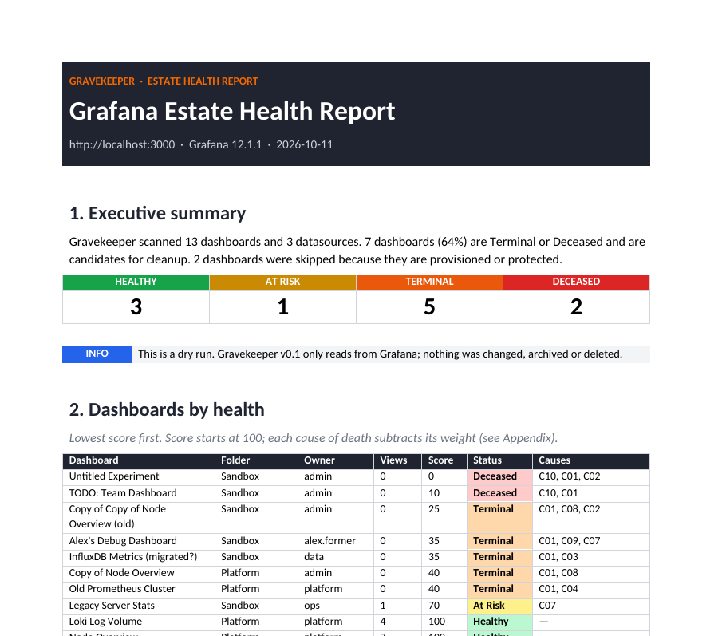
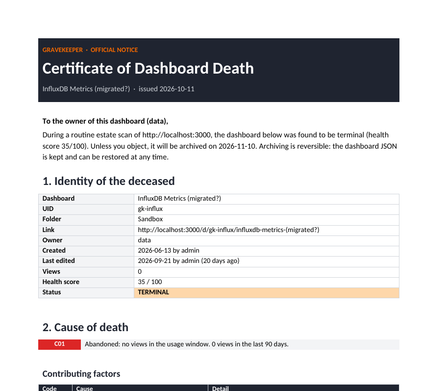

<div align="center">

# 🪦 Gravekeeper

**Find dead, broken and abandoned Grafana dashboards, and write them a Death Certificate.**

[](https://github.com/AramEvin/gravekeeper/actions/workflows/ci.yml)
[](https://github.com/AramEvin/gravekeeper/releases)


[](LICENSE)

*Observability for your observability.*

</div>

---

Every Grafana instance older than a year collects zombies: dashboards nobody opens, copies of copies, panels pointing at deleted datasources, and Angular panels that stopped rendering after the Grafana 11/12 upgrades. Admins don't dare delete anything, because nobody knows who still uses what.

**Gravekeeper** scans your Grafana, measures real usage from Grafana's own request logs in Loki, gives every dashboard a **health score**, and produces:

- an **Estate Health Report** for the platform team
- a **Certificate of Dashboard Death** for each Terminal or Deceased dashboard, to send to its owner with a grace period to object

It is **read-only**: Gravekeeper never changes, archives or deletes anything.

| Estate Health Report | Death Certificate |
|---|---|
|  |  |

Download the full examples: [estate-health-report.docx](examples/estate-health-report.docx) · [death-certificate-example.docx](examples/death-certificate-example.docx)

## What it detects

| Code | Cause of death | Weight |
|---|---|---|
| C01 | **Abandoned:** no views in 90 days (from Grafana's request logs in Loki) | −40 |
| C02 | **Stale:** not edited in 180 days | −15 |
| C03 | **Orphaned datasource:** panel uses a datasource that no longer exists | −25 |
| C04 | **Broken datasource:** datasource fails its health check | −20 |
| C07 | **Legacy panel:** Angular `graph`, `singlestat`, `table-old`, … | −10 each |
| C08 | **Duplicate:** same queries as another dashboard | −20 |
| C09 | **Ownerless:** no `owner:` tag and the creator has left | −15 |
| C10 | **Empty shell:** no panels showing data | −50 |

Score 80+ is **Healthy**, 50–79 **At Risk**, 20–49 **Terminal**, and below 20 **Deceased**. Provisioned dashboards and dashboards tagged `keep-alive` or `critical` are never flagged. Details: [docs/causes.md](docs/causes.md).

## Quick start: demo in 5 minutes

Requires Python 3.9+ and Docker.

```bash
git clone https://github.com/AramEvin/gravekeeper.git && cd gravekeeper
python3 -m venv .venv && source .venv/bin/activate
pip install -e .

docker compose -f demo/docker-compose.yml up -d   # Grafana 12, Prometheus, Loki, Alloy
python demo/seed.py                               # 12 test dashboards + a token
export GRAFANA_TOKEN=glsa_...                     # paste the token seed.py printed

gravekeeper check -c demo/gravekeeper.demo.yaml
gravekeeper run   -c demo/gravekeeper.demo.yaml
```

```
Scanned 11 dashboards, skipped 2: Deceased 2, Healthy 3, Terminal 6
   10  Deceased  Untitled Experiment                           C10,C01
   30  Terminal  Legacy Server Stats                           C01,C07
   35  Terminal  Alex's Debug Dashboard                        C01,C09,C07
   35  Terminal  InfluxDB Metrics (migrated?)                  C01,C03
   40  Terminal  Copy of Node Overview                         C01,C08
  100  Healthy   Node Overview                                 -
  ...
Estate report    : out/estate-health-report.docx
Death certificates: 8 in out/certificates
```

Open http://localhost:3000 (admin/admin) to see the dashboards being judged. Then change something, such as adding the tag `owner:me` to a dashboard or opening it in the browser, and run the scan again to watch the score change.

## Use it on your own Grafana

1. **Create a service account** in Grafana (*Administration → Users and access → Service accounts*) with the **Admin** role. Gravekeeper only sends `GET` requests, but listing datasources and org users needs Admin. Create a token for it.
2. **Configure:**
   ```bash
   pip install git+https://github.com/AramEvin/gravekeeper.git
   cp gravekeeper.example.yaml gravekeeper.yaml     # set grafana.url
   export GRAFANA_TOKEN=glsa_...
   gravekeeper check
   gravekeeper run
   ```
3. **Optional: enable view counts (C01).** Set `router_logging = true` in Grafana, ship its logs to Loki, and set `usage.source: loki`. See [docs/view-counting.md](docs/view-counting.md). Collect a few weeks of logs before trusting C01.

### Commands

| Command | What it does |
|---|---|
| `gravekeeper check` | Tests the connection, token, permissions and Loki |
| `gravekeeper scan` | Writes `out/findings.json` |
| `gravekeeper report` | Renders the DOCX files from `out/findings.json` |
| `gravekeeper run` | `scan` + `report` |
| `gravekeeper templates --out my-templates` | Copies the Word templates so you can restyle them; then `gravekeeper report --templates my-templates` |

All options are documented in [gravekeeper.example.yaml](gravekeeper.example.yaml).

## How it works

Gravekeeper reads dashboards and datasources from the Grafana API, and counts views from Grafana's own request logs in Loki. Its own service-account requests are excluded, so scanning never keeps a dashboard alive. Results go to `findings.json`, and the DOCX reports are rendered from Word templates with [docxtpl](https://docxtpl.readthedocs.io). More in [docs/architecture.md](docs/architecture.md).

Tested against **Grafana 12.1.1** and **Loki 3.5.3**.

## Roadmap

- [x] **v0.1:** read-only scan, 8 causes of death, view counts from Loki, DOCX reports, demo stack
- [ ] **v0.2:** query replay to find erroring (C05) and empty (C06) panels; alert-rule dependencies
- [ ] **v0.3:** notifications (Slack, email, GitHub/Jira issues) and appeals via the `keep-alive` tag
- [ ] **v0.4:** archive to Git, Graveyard folder, Burial Records, restore command
- [ ] **v1.0:** GitHub Action / Kubernetes CronJob, Grafana Cloud usage insights, estate-health dashboard

## Troubleshooting

| Symptom | Fix |
|---|---|
| `401 Unauthorized` | Set `GRAFANA_TOKEN` to a valid service-account token |
| `403 Forbidden` on datasources | Give the service account the Admin role |
| `Cannot reach Loki` | Start Loki, fix `usage.loki_url`, or set `usage.source: none` |
| `View logs: 0 dashboards viewed` | Enable `router_logging`; check your `usage.selector` matches Grafana's log labels |
| Every dashboard shows C01 | Not enough log history yet: use `usage.source: none` for now |
| Loki `maximum of series reached` | Raise `limits_config.max_query_series` in Loki |

## Contributing

Contributions are very welcome, especially new causes of death, template designs and translations. See [CONTRIBUTING.md](CONTRIBUTING.md). Development needs no Docker: the tests run against a mock Grafana.

```bash
make dev && make test && make lint
```

## License

[Apache-2.0](LICENSE). Not affiliated with Grafana Labs. Grafana is a trademark of Grafana Labs.
